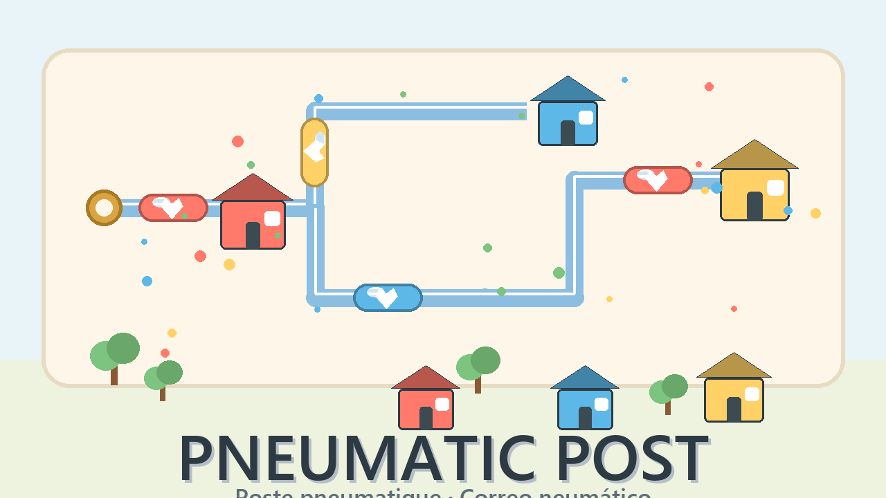

# Pneumatic Post · Poste pneumatique · Correo neumático

A miniature city needs its mail network. Capsules travel through transparent
pneumatic tubes and must reach the right house — the one with **their colour
and their symbol**. You build the network first, then press **LAUNCH** and
watch the mail fly.

## Play

Open `index.html` — the game is a single self-contained file
(HTML + Canvas 2D + Web Audio, no dependencies, no network calls, works
offline). Play it also on LOB7 or GitHub Pages.

## Rules

- The board is a **6×6 grid** with brass **entry ports**, **trees** you cannot
  build on, and **houses** waiting for mail.
- Drag pipes from the tray onto the grid. Tap a placed piece to rotate it.
  Drag it back to the tray to remove it. Your **inventory is limited**.
- Pieces: **straight pipe** · **elbow** · **crossing** (two lines share one
  square without mixing) · **switch** (sends *its own marked category* to the
  side branch — every other capsule continues straight through).
- Press **LAUNCH**. Capsules leave the ports in the order shown by the little
  queue beside each port, always spaced so they never block each other.
- A run **fails** if a capsule is **lost** (a gap in the tubes), reaches a
  **wrong house**, or gets trapped in an **endless loop** — the game detects
  exit-less circuits, it never simulates forever. After a run, **the network
  stays in place** so you can fix it and try again.
- **10 hand-designed levels**: one house first, then more categories, then
  switches, shared crossings and a final grand sorting office.
- Solve a level for ★★. Build it with **as few pieces as the 3★ target** for
  ★★★ (the target is shown above the board).

## Controls

| Action | How |
|---|---|
| Place a piece | drag it from the tray onto a square |
| Rotate | tap / click the placed piece |
| Move / remove | drag a placed piece (drop on the tray to remove) |
| Run / stop | **LAUNCH** / **STOP** buttons |
| Language | EN · FR · ES selector (English by default) |

Everything works with touch (pointer events), mouse and keyboard
(Enter = launch, Esc = stop).

## Development

- Single-file game: `index.html` (engine, 10 levels, i18n EN/FR/ES,
  synthesized audio, `localStorage` guarded).
- The routing engine (`routePiece`, `planCapsule`, `planRun`, `simulate`) is
  pure and DOM-free; it is exposed as `window.__PP_ENGINE__` and driven by the
  Node test suite in the workshop (`games/poste-pneumatique-dev/`, not part of
  this repository).
- Every level ships a **recorded solution**; the tests prove each one routes
  every capsule home with no loss, no wrong address and no loop.
- `?debug=1` adds a small FPS/state overlay. QA hook: `window.__PP__`.

## Credits & license

- Concept: Cédric Bernadac. Made by Z-Code (with a Kimi K3.1 Pro pacing
  review — see LOB7-ATTRIBUTION.json).
- Code and art: MIT — see [LICENSE](LICENSE).
